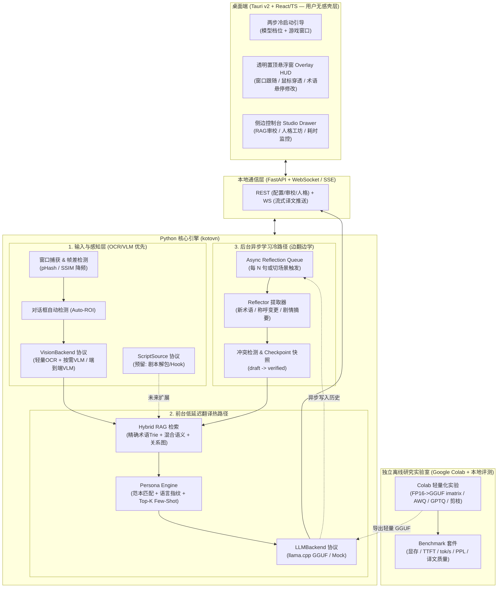

# KotoVN 系统架构设计文档

> **项目定位**：面向视觉小说（Visual Novel, VN）的**本地优先（Local-First）**、**用户无感（Zero-Friction）**多模态 LLM + 动态 RAG 翻译器，同时也是一个用于系统性研究 **LLM 轻量化/量化、轻量视觉模块、在线 RAG 维护与人格风格化生成** 的开源工程项目。

---

## 1. 核心设计原则

1. **100% 本地推理，云端仅用于离线轻量化研究**
   - **运行时（Runtime）**：完全在用户本机执行，**默认优先支持纯 CPU 推理与 CPU+GPU 混合卸载**（针对 12GB 显存环境，避免挤占游戏本体与系统桌面显存）。
   - **研究环境（Google Colab）**：**严禁用于部署在线翻译服务**；仅用于高显存消耗的离线研究任务（如 FP16/BF16 权重转换、`imatrix` 校准矩阵计算、AWQ/GPTQ 量化、量化前后质量与困惑度消融实验），产出的轻量化权重再回到本地验证与运行。
2. **输入先走 OCR/VLM 读屏，面向剧本解包预留稳定接口**
   - Phase 1–2 专注 **无需解包、开箱即用** 的屏幕捕获 + 轻量 OCR/VLM 方案。
   - 核心引擎不直接耦合图像像素，而是消费统一的 `DialogueFrame` 契约；未来接入 Ren'Py / Kirikiri / Artemis 等剧本解包器或 Textractor 钩子时，只需新增 `ScriptSource` 实现，无需改动下游 RAG、人格与翻译管线。
3. **用户无感交互（Zero-Friction UX）**
   - 除初次启动的**两步引导（选硬件档位/模型 + 选游戏窗口）**外，用户日常游玩无需手动框选、无需频繁调参。
   - 透明悬浮窗自动吸附并跟随游戏窗口移动/最小化；背景“边翻边学”异步静默执行。
4. **严格接口解耦与无 GPU 可测性**
   - 所有模型与存储后端（LLM、Vision、VectorStore、Reflector）均通过 Python `Protocol` 抽象，配套确定性 `Mock` 实现与录制回放夹具，确保 GitHub Actions 无 GPU 环境下依然可以完整运行单元测试与集成测试。

---

## 2. 硬件预算与本地运行时档位

基于典型中端开发/游戏主机（参考基准：`AMD Ryzen 7 5800X3D` 16 线程 AVX2 + `RTX 5070 12GB VRAM`），本地运行时提供三档自适应 Profile（见 `kotovn.config.RuntimeProfile`）：

| 运行档位 | 目标场景 | 翻译 LLM 策略 | 视觉与 Embedding 策略 | 预计显存 / 内存占用 |
| :--- | :--- | :--- | :--- | :--- |
| **`cpu_only`（推荐默认/节能）** | 仅用 CPU 推理，零显存占用，完全不与游戏争抢 GPU | `llama.cpp` (GGUF `Q4_K_M` / `IQ4_XS`, 3B–8B), `n_gpu_layers=0`, KV Cache `Q8_0` | ONNX Runtime CPU (`RapidOCR/Manga-OCR` + `bge-small` ONNX) | VRAM: **0 GB** RAM: ~3.5–6.5 GB |
| **`hybrid_12gb`（均衡性能）** | 12GB 显卡上与游戏共存，追求更低首字延迟（TTFT） | `llama.cpp` GGUF 7B–9B (`Q4_K_M` / `Q5_K_M`) 部分或全部层卸载至 GPU（限额 <= 6GB VRAM） | OCR/Embedding 放 CPU，按需触发的紧凑 VLM (2B–3B) 共享或切换显存 | VRAM: **<= 6.0 GB** RAM: ~2.5–4.0 GB |
| **`research_gpu`（实验模式）** | 仅运行本地评测、不启动游戏时的极限速度/多模型对比 | 9B–14B 量化模型全 GPU 卸载，或原生测试 FP8/INT4/AWQ | 端到端紧凑 VLM（如 Qwen2.5-VL-3B / MiniCPM-V）全量开启 | VRAM: **8–11 GB** |

> **为什么统一优先采用 `llama.cpp` (GGUF) + `ONNX Runtime`？**
> 同一份 GGUF 权重文件可以通过单个参数 `n_gpu_layers` 在「纯 CPU」「混合卸载」「全 GPU」之间无缝切换，且原生支持 KV Cache 量化与 AVX2/FMA 加速；视觉 OCR 与向量嵌入采用 ONNX Runtime 跑在 CPU 上，可彻底规避多框架（PyTorch + CUDA）同时常驻导致的显存碎片与 2GB+ CUDA Context 固定开销。

---

## 3. 总体分层架构

---

## 4. 模块职责与数据契约

核心数据模型集中在 `backend/src/kotovn/schemas/`，并同步映射到前端 `desktop/src/types/protocol.ts`：

1. **`DialogueFrame`（统一输入契约）**
   - 字段：`frame_id`, `source_type` (`ocr` | `vlm` | `script`), `raw_text`, `speaker_raw`, `visual_context`（表情、场景、画面变化标记）, `roi_box`, `timestamp`。
   - **设计价值**：当前由 `VisionBackend` 填充，未来 `ScriptSource` 直接产出同一结构，下游零改造。
2. **`TranslationResult`（流式与终态输出）**
   - 字段：`frame_id`, `source_text`, `translated_text`, `speaker_resolved`, `glossary_hits`（用于在 HUD 中高亮可点击词条）, `persona_id`, `telemetry`（视觉耗时、RAG 耗时、TTFT、生成速度 tok/s）。
3. **存储与状态分层**
   - **配置层**：本地 YAML/JSON（`~/.config/kotovn/`），保存硬件档位、模型路径与热键。
   - **每游戏独立库（Per-Game Workspace）**：每个游戏自动以窗口进程名/标题哈希建立独立目录（`data/games/<game_id>/`），隔离不同作品的术语表、记忆向量、人物人格卡片与分支 Checkpoint，防止跨游戏知识污染。

---

## 5. 轻量视觉模块架构演进（学习目标 #2）

针对视觉小说「画面绝大部分时间静止，仅文本框逐字打字机刷新、偶尔切换立绘表情与背景」的特征，视觉模块采用**事件驱动 + 分层降载**：

1. **稳定帧门控（Stability Gate）**：
   - 以 4–6 FPS 轻量轮询目标窗口缩略图。
   - 利用帧差过滤打字机动画：连续两帧文本框区域哈希一致（稳定约 180–250ms）才触发识别，避免对半句话重复翻译。
2. **双路线可插拔实验**：
   - **模式 A（CPU 极致轻量两阶段）**：`Auto-ROI` 裁出对话框 + 角色名框 -> 轻量 ONNX OCR 提取高准确率原文；仅当背景/立绘区域 pHash 跳变时，异步触发轻量视觉编码器或小型 VLM 更新 `visual_context`（情绪/场景标签）。
   - **模式 B（紧凑 VLM 端到端）**：接入 2B–4B 紧凑 VLM（`Qwen2.5-VL-3B` / `SmolVLM` / `MiniCPM-V`），重点实验 **ROI 裁剪 + 动态分辨率上限控制** 对视觉 Token 数与推理延迟的影响。

---

## 6. 工程规范与 CI/CD 策略（学习目标 #5）

* **Monorepo 结构**：`backend/`（Python 核心引擎与本地服务）、`desktop/`（Tauri v2 + React 前端）、`research/`（LLM 轻量化与视觉研究实验）、`docs/`（架构与设计文档）。
* **质量门禁**：
  - Python：`uv` 依赖锁定 + `ruff`（代码检查与格式化）+ `mypy --strict` + `pytest`（覆盖率报告）。
  - Desktop：TypeScript 严格模式（`tsc --noEmit`）+ Vite 构建验证。
  - Research：验证实验脚本语法与评测数据集 JSONL Schema 完整性。
* **自动化发布**：基于 Conventional Commits + Git Tag (`vX.Y.Z`) 触发 GitHub Actions 自动打包与 Release 发布。
